# CityPulse - Backend and AI/ML

From a parking-lot camera image to a free slot and a licence plate number.

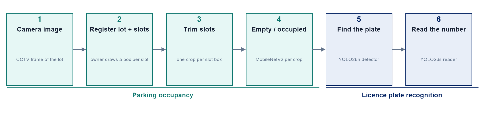

| Part | Sections |
|---|---|
| System | 1. Architecture |
| Owner sets up a lot (backend) | 2. Camera and slots · 3. Trim slots |
| AI pipeline | 4. Empty / occupied · 5. Find the plate · 6. Read the number |
| Drivers and city | 7. Find and book · 8. Predicted traffic jams |

---

## 1. Architecture

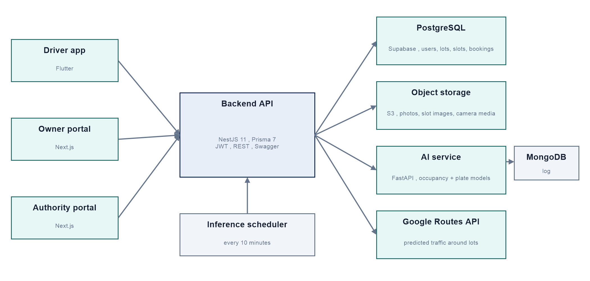

- **Apps** (Flutter driver app, Next.js owner and authority portals) only talk to the **backend**.
- The **backend** (NestJS 11, Prisma 7) owns all data in **PostgreSQL** (Supabase) and files in **S3 storage**, and calls the **AI service** (FastAPI, PyTorch) with a shared token.
- An **inference scheduler** in the backend refreshes slot occupancy every 10 minutes.
- **Google Routes API** gives predicted traffic around each lot.

**Code:** <a href="https://github.com/rahad-dll/499/tree/feature/backend/applications/web/backend/src" target="_blank">backend `src/`</a> · <a href="https://github.com/rahad-dll/499/tree/feature/backend/applications/ai/api-services" target="_blank">AI service</a> · <a href="https://github.com/rahad-dll/499/tree/feature/backend/applications/ai/ai-models" target="_blank">AI models</a>

---

## 2. Steps 1–2 - Camera image and slot registration

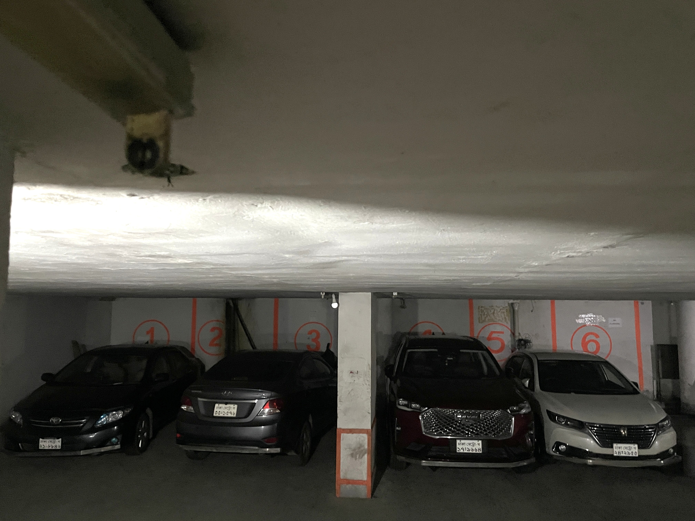

A real frame from a Dhaka basement parking. The owner draws a box for every slot the camera sees - here slots 1–4:

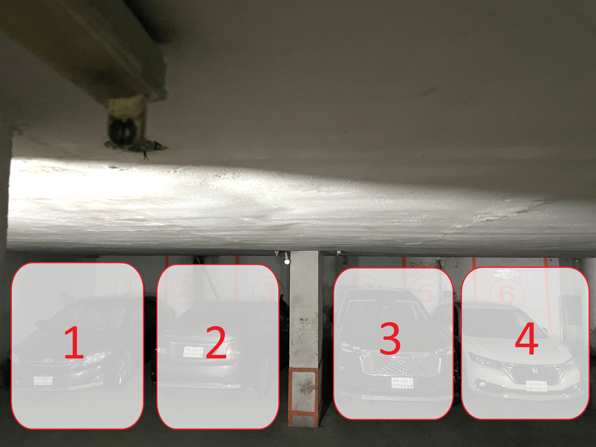

The lot is registered in small steps - **one camera per request**, so a network or power failure loses at most one camera:

| # | Request | Result |
|---|---|---|
| 1 | `POST /spaces` | lot created, status `pending` |
| 2 | `PUT /spaces/:id/rates/:vehicleType` | hourly price per vehicle type (car, motorcycle, CNG, …) |
| 3 | `POST /spaces/:id/cameras` | one camera (RTSP stream or uploaded video, frame size) **and its slots** |
| 4 | `PATCH` / `GET /spaces/:id/cameras` | edit later; list cameras, slots, boxes and prices |
| 5 | `PATCH /admin/spaces/:id/status` | admin approves → `active`, drivers can book |

The backend checks every camera: boxes inside the frame and not overlapping, slot labels unique in the lot, a price for every slot (its own or the vehicle rate), slot type from the vehicle (car → standard, CNG → compact, truck / SUV / microbus → large). Boxes are stored as fractions of the frame (0–1), so they survive a resolution change.

Data model: 23 PostgreSQL tables; 499B added cameras with media, slot details, `rate_plans`, `discounts` and booking fields. More: <a href="docs/overview/02-erd.png" target="_blank">database diagram</a>

**Code:** <a href="https://github.com/rahad-dll/499/blob/feature/backend/applications/web/backend/src/spaces/cameras.service.ts" target="_blank">cameras.service.ts</a> · <a href="https://github.com/rahad-dll/499/blob/feature/backend/applications/web/backend/src/spaces/rates.service.ts" target="_blank">rates.service.ts</a> · <a href="https://github.com/rahad-dll/499/blob/feature/backend/applications/web/backend/src/spaces/slots.service.ts" target="_blank">slots.service.ts</a> · <a href="https://github.com/rahad-dll/499/blob/feature/backend/applications/web/backend/src/admin/admin.service.ts" target="_blank">admin.service.ts</a> · <a href="https://github.com/rahad-dll/499/blob/feature/backend/applications/web/backend/prisma/schema.prisma" target="_blank">schema.prisma</a> · <a href="https://github.com/rahad-dll/499/tree/feature/backend/applications/web/backend/prisma/migrations" target="_blank">migrations</a>

---

## 3. Step 3 - Trim each slot out of the frame

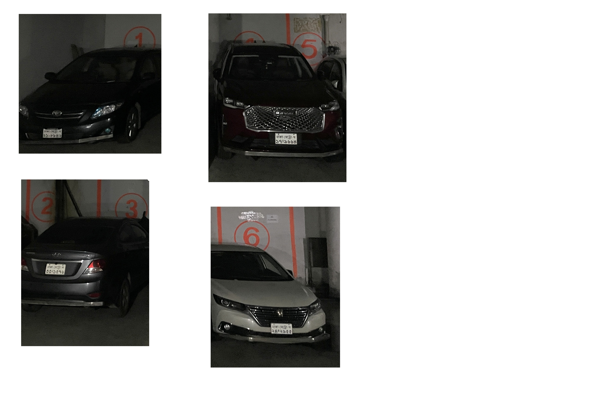

Each slot's box cuts its own crop, so the models look at one slot at a time:

| Slot 1 | Slot 2 | Slot 3 | Slot 4 |
|---|---|---|---|
| 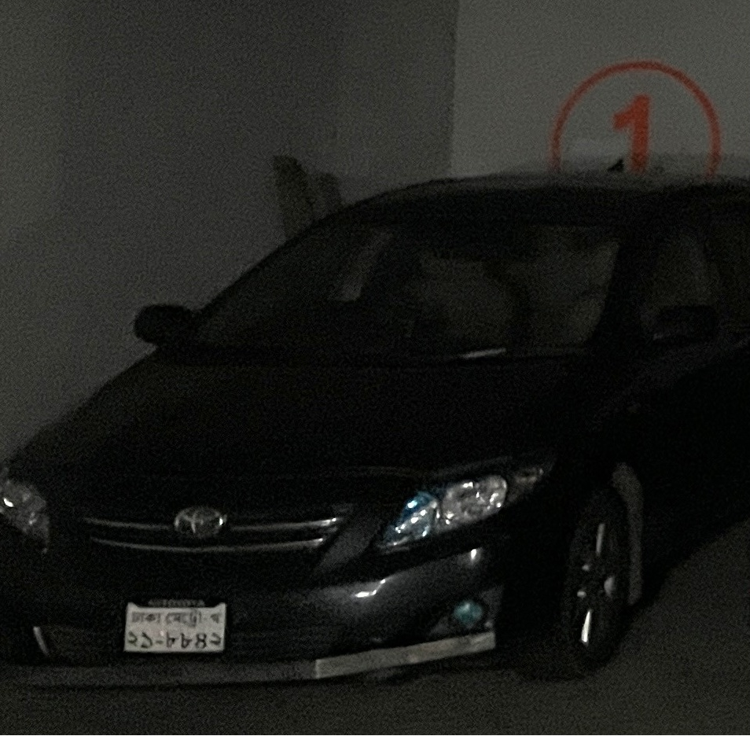 | 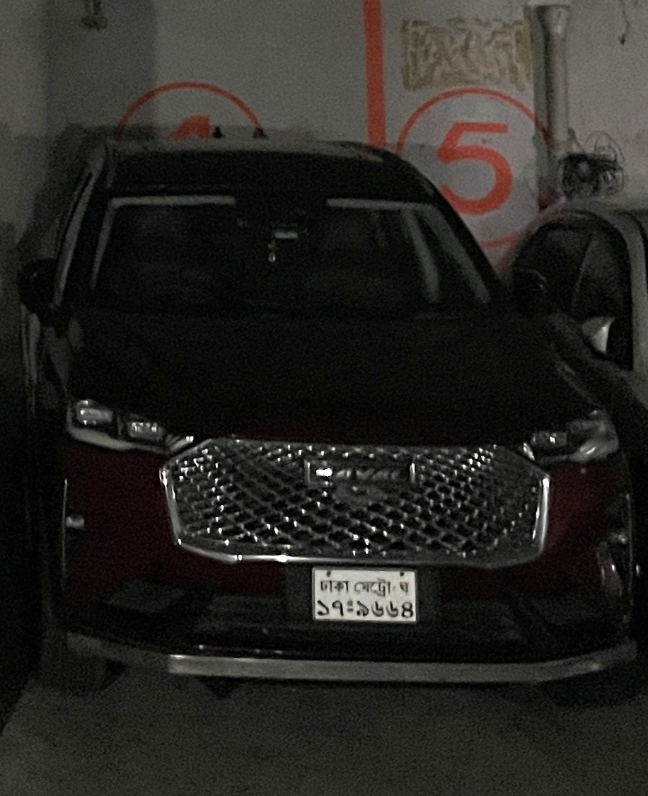 | 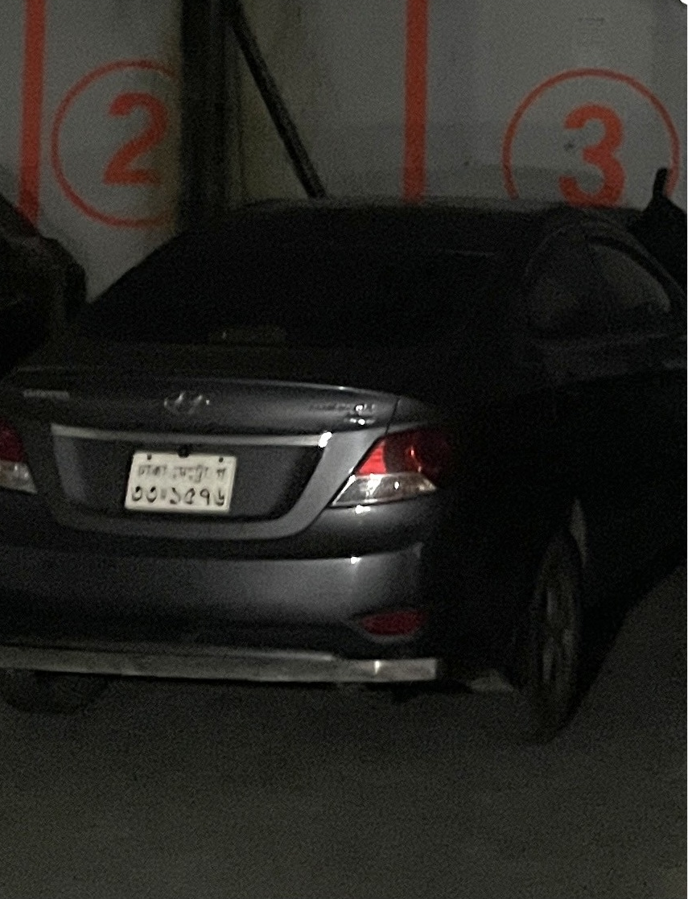 | 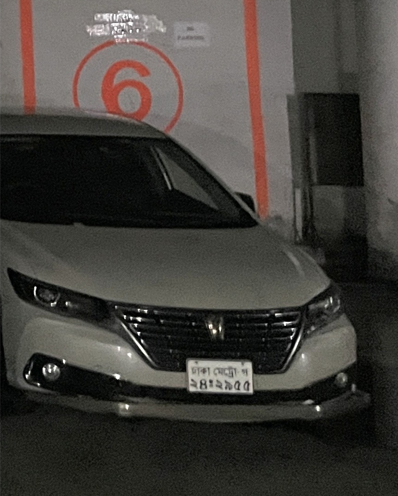 |

The owner draws each box in pixels; the backend saves it as fractions of the frame and turns it back into pixels before cutting. Example on a 1920 × 1080 frame:

```
drawn box   x = 192   y = 594   width = 384   height = 270          (pixels, from the owner)
saved box   x1 = 192 / 1920 = 0.10           y1 = 594 / 1080 = 0.55
            x2 = (192 + 384) / 1920 = 0.30   y2 = (594 + 270) / 1080 = 0.80
pixels      left = 0.10 × 1920 = 192    right  = 0.30 × 1920 = 576
            top  = 0.55 × 1080 = 594    bottom = 0.80 × 1080 = 864
crop        the rectangle from (192, 594) to (576, 864)
```

Every crop goes to step 4; an occupied crop also goes to steps 5–6.

---

## 4. Step 4 - Empty or occupied

Real test on two slot images - both occupied, 100% confidence:

<p>
  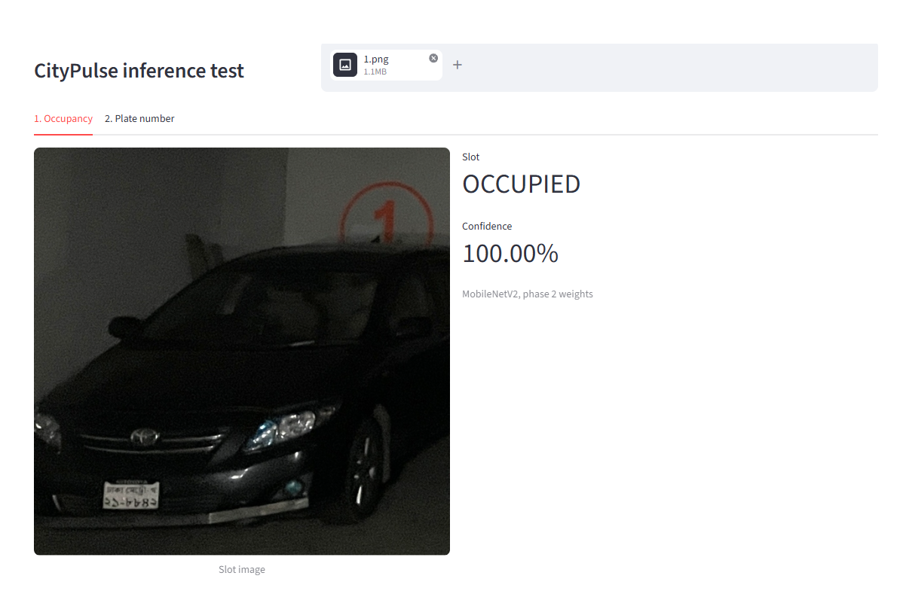
  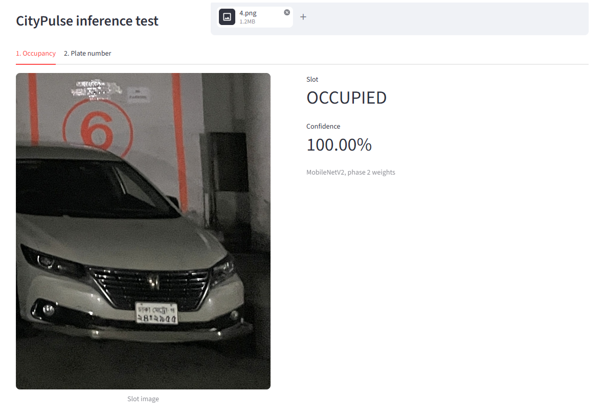
</p>

Every 10 minutes the scheduler sends each slot image to the AI service (`POST /api/v1/inference/predict` → `empty` / `occupied` + confidence) and writes the result to `parking_slots`, which the apps read. A slot with a running booking is marked occupied without calling the model. Predictions are logged in MongoDB for 30 days.

| Model | Data | Accuracy |
|---|---|---|
| **MobileNetV2** (served) | 808,991 slot crops, PKLot + CNRPark+EXT | 97.28% → **99.18%** after fine-tuning, on an unseen lot (UFPR05) |
| VPS-Net occupancy stage (paper reproduction) | VPS-Net data | 98.53% (paper: 99.48%) |

More: <a href="docs/overview/06-occupancy-training.png" target="_blank">training curves</a> · <a href="docs/overview/06-occupancy-confusion.png" target="_blank">confusion matrix</a>

**Code:** <a href="https://github.com/rahad-dll/499/blob/feature/backend/applications/web/backend/src/spaces/inference-scheduler.service.ts" target="_blank">inference-scheduler.service.ts</a> · <a href="https://github.com/rahad-dll/499/blob/feature/backend/applications/ai/api-services/predictor.py" target="_blank">predictor.py</a> · <a href="https://github.com/rahad-dll/499/tree/feature/backend/applications/ai/ai-models/parking-occupancy" target="_blank">parking-occupancy model</a> · <a href="https://github.com/rahad-dll/499/tree/feature/backend/applications/ai/ai-models/parking-slot-detection" target="_blank">VPS-Net reproduction</a>

---

## 5. Step 5 - Find the licence plate

YOLO26n finds every plate in the image - on the real test slots it finds the plate with 0.74 (slot 1) and 0.94 (slot 6) confidence (images in step 6).

Three public Bangla datasets merged: **8,236 / 831 / 865** images, **867 near-duplicates removed** so no test image appears in training.

| Model | Paper test (553) | Full test (865) | ms per image (T4) |
|---|---|---|---|
| **YOLO26n** | 0.991 | **0.981** | **3.0** |
| YOLO26s | 0.990 | 0.980 | 7.7 |
| YOLO26m | 0.988 | 0.978 | 23.7 |
| YOLOv8m - paper setup, reproduced | 0.991 | 0.910 | 20.9 |
| YOLOv8m two-stage - paper setup, reproduced | 0.994 | 0.912 | 20.4 |

mAP@0.5. The smallest model (2.4M parameters) matches the paper's 25.8M one; models trained on one dataset drop to 0.91 on the others. The paper's YOLOv8m accuracy was matched (97.11%); its two-stage gain was not (96.93% vs 97.83%).

More: <a href="docs/overview/07-plate-detector-training.png" target="_blank">training curves</a>

**Code:** <a href="https://github.com/rahad-dll/499/tree/feature/backend/applications/ai/ai-models/plate-recognition" target="_blank">plate-recognition</a> · <a href="https://github.com/rahad-dll/499/tree/feature/backend/applications/ai/ai-models/plate-recognition/notebooks/kaggle" target="_blank">Kaggle notebooks</a>

---

## 6. Step 6 - Read the number

<p>
  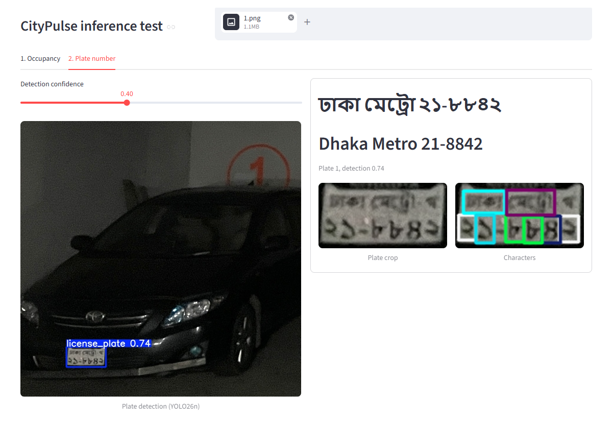
  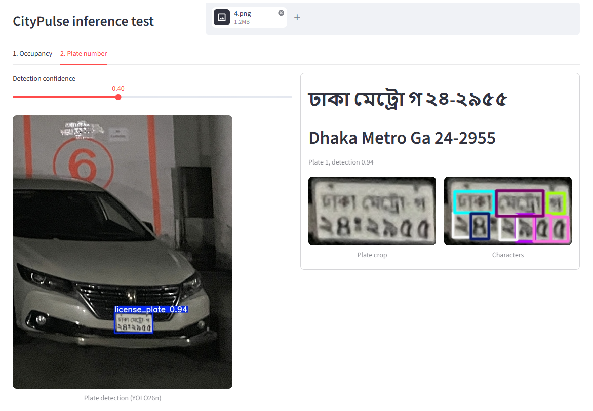
</p>

Slot 6 is read in full (Dhaka Metro Ga 24-2955). Slot 1 misses the faint series letter খ (Dhaka Metro 21-8842). Detector + reader take ≈ **6 ms per plate on a T4**.

YOLO26s finds every digit, letter, district name and "Metro" on the plate crop as its own box; the boxes become text - words and letter first, then digits, left to right - in Bangla and in English (English is stored in the database):

```
Dhaka · Metro · Ga · 1 2 3 4 5 6   →   ঢাকা মেট্রো গ ১২-৩৪৫৬   /   Dhaka Metro Ga 12-3456
```

| Reader (same 218 test plates) | Plates fully correct | Character error rate | ms per plate |
|---|---|---|---|
| YOLO26n | 71.1% | 5.5% | **1.3** |
| **YOLO26s** | **75.7%** | **4.4%** | 2.5 |
| ViT + BanglaBERT - paper method, reproduced | 31.2% | 21.2% | 43.7 |

The paper's reader (13.23% CER on its own dataset, no longer public) memorises its training plates (7.6% CER) and invents digits on new ones. Reading each character from its own box cannot invent digits - 4× lower error, 17× faster.

Dataset: **103 classes** (10 digits, 26 letters, 3 words, 64 districts), **6,294 / 1,448 / 778** plate crops; **2,001 collage images** with blanked, unlabelled digits removed.

More: <a href="docs/overview/08-plate-reading-labels.jpg" target="_blank">ground-truth labels</a> · <a href="docs/overview/08-plate-reader-training.png" target="_blank">training curves</a> · <a href="docs/overview/08-plate-reader-confusion.png" target="_blank">confusion matrix</a>

**Code:** <a href="https://github.com/rahad-dll/499/tree/feature/backend/applications/ai/ai-models/plate-num-read" target="_blank">plate-num-read</a> · <a href="https://github.com/rahad-dll/499/tree/feature/backend/applications/ai/ai-models/plate-num-read/notebooks/kaggle" target="_blank">Kaggle notebooks</a>

---

## 7. Drivers find and book a free slot

The occupancy from step 4 is what drivers see.

| # | Request | Result |
|---|---|---|
| 1 | `GET /spaces/nearby?lat&lng` | lots within 5 km with free / occupied / unknown counts |
| 2 | `GET /spaces/:id/slots?from&to` | slots with no booking in that time window |
| 3 | `POST /bookings` | books a chosen or the first free slot |
| 4 | `PATCH /bookings/:id/cancel`, `DELETE /bookings/:id` | cancel; hide finished bookings from history |

Only approved lots can be booked; a slot with a current or upcoming booking cannot be deleted.

**Code:** <a href="https://github.com/rahad-dll/499/blob/feature/backend/applications/web/backend/src/bookings/bookings.service.ts" target="_blank">bookings.service.ts</a> · <a href="https://github.com/rahad-dll/499/blob/feature/backend/applications/web/backend/src/spaces/spaces.service.ts" target="_blank">spaces.service.ts</a>

---

## 8. Predicted traffic jams

Goal: know 30 minutes in advance if the roads around a lot will be jammed, so drivers can be offered a free slot nearby.

How it works, for each lot:

1. Take 4 roads into the lot, starting 2 km away to the north, east, south and west (map below).
2. Ask Google Routes for each road's travel time **30 minutes from now** (Google predicts it from traffic history).
3. Ask for the same road's travel time at **3 am**, when the road is empty - the normal time.
4. Divide: `delay_ratio` = time in 30 minutes ÷ time at 3 am.

| `delay_ratio` | Level | A road that takes 10 min at 3 am |
|---|---|---|
| below 1.3 | `normal` | under 13 min in 30 minutes |
| 1.3 - 1.8 | `slow` | 13 - 18 min |
| 1.8 or more | `jam` | 18 min or more |

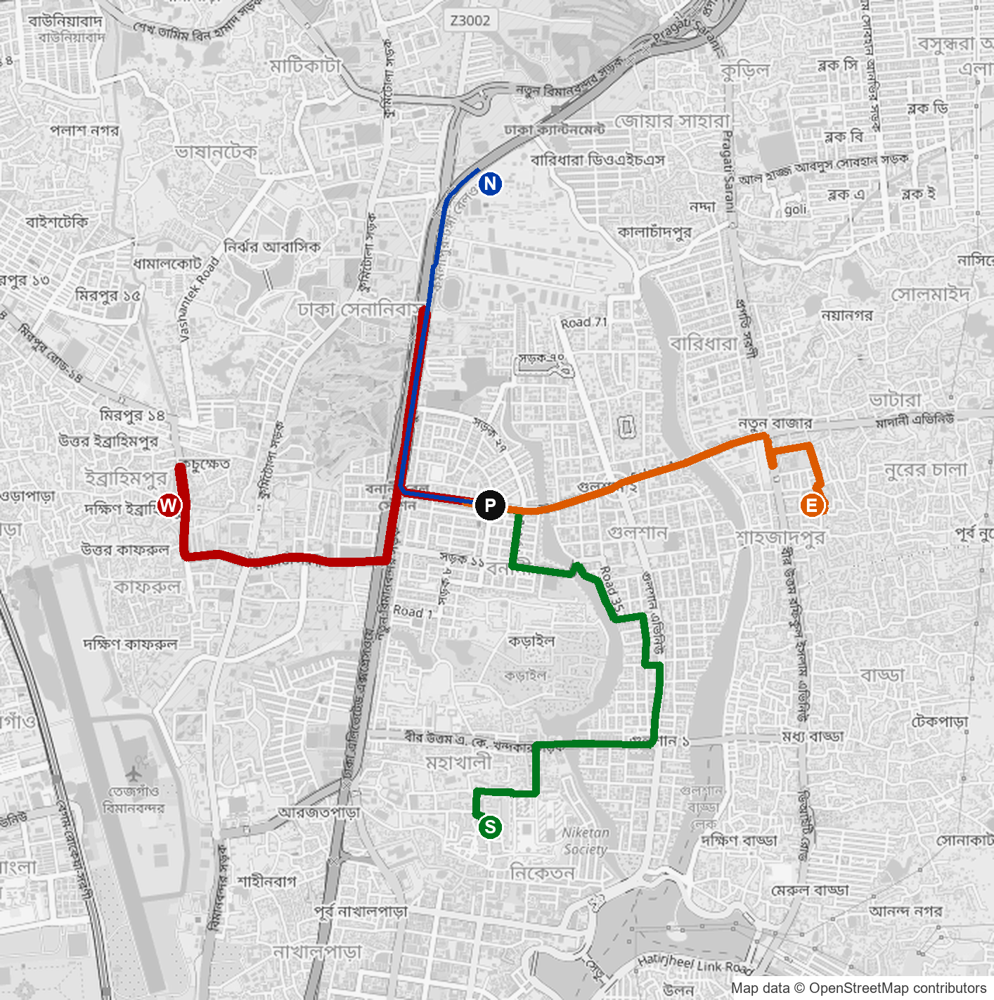

The four roads into a Gulshan lot (P), as returned by the Routes API: from 2 km north (N), east (E), south (S) and west (W).

**Request** - `POST https://routes.googleapis.com/directions/v2:computeRoutes`

```json
{
  "origin":      { "location": { "latLng": { "latitude": 23.8117, "longitude": 90.4066 } } },
  "destination": { "location": { "latLng": { "latitude": 23.7937, "longitude": 90.4066 } } },
  "travelMode": "DRIVE",
  "routingPreference": "TRAFFIC_AWARE_OPTIMAL",
  "trafficModel": "BEST_GUESS",
  "departureTime": "2026-11-01T20:00:00.000Z"
}
```

**Response** - `{ "routes": [ { "duration": "249s" } ] }`

**Backend result** - `TrafficService.getSpaceForecast(space)`, a real run for a Gulshan lot at 2 am (all roads `normal`):

```json
{
  "space_id": "gulshan-test",
  "predicted_for": "2026-11-01T20:00:00.000Z",
  "jam_expected": false,
  "routes": [
    { "direction": "north", "predicted_seconds": 249, "baseline_seconds": 246, "delay_ratio": 1.01, "level": "normal" },
    { "direction": "east",  "predicted_seconds": 620, "baseline_seconds": 629, "delay_ratio": 0.99, "level": "normal" },
    { "direction": "south", "predicted_seconds": 831, "baseline_seconds": 815, "delay_ratio": 1.02, "level": "normal" },
    { "direction": "west",  "predicted_seconds": 641, "baseline_seconds": 708, "delay_ratio": 0.91, "level": "normal" }
  ]
}
```

`jam_expected` is true when any road reaches `jam`. Results are cached (10 min, baselines 24 h) to stay inside the free quota.

### Google's built-in jam signals

The same Routes API can also report the jam itself, without the 3 am request:

| Signal | How to ask | What comes back |
|---|---|---|
| `staticDuration` | add it to the field mask | travel time **with no traffic**, next to `duration` (with traffic) - the ratio from one request |
| Traffic per road stretch | `"extraComputations": ["TRAFFIC_ON_POLYLINE"]`, field `routes.travelAdvisory.speedReadingIntervals` | each stretch of the route labelled `NORMAL`, `SLOW` or `TRAFFIC_JAM` |

Test for 8:30 am Dhaka time (requested 30 minutes ahead):

| Road | With traffic | No traffic | Ratio | Stretches |
|---|---|---|---|---|
| Mirpur 10 → Agargaon | 761 s | 678 s | 1.12 | 2 `NORMAL`, 1 `TRAFFIC_JAM` |
| Farmgate → Shahbag | 848 s | 630 s | 1.35 | 1 `NORMAL` |
| Gulshan, north road | 487 s | 349 s | 1.40 | 1 `NORMAL` |

**Code:** <a href="https://github.com/rahad-dll/499/blob/feature/backend/applications/web/backend/src/traffic/traffic.service.ts" target="_blank">traffic.service.ts</a>
